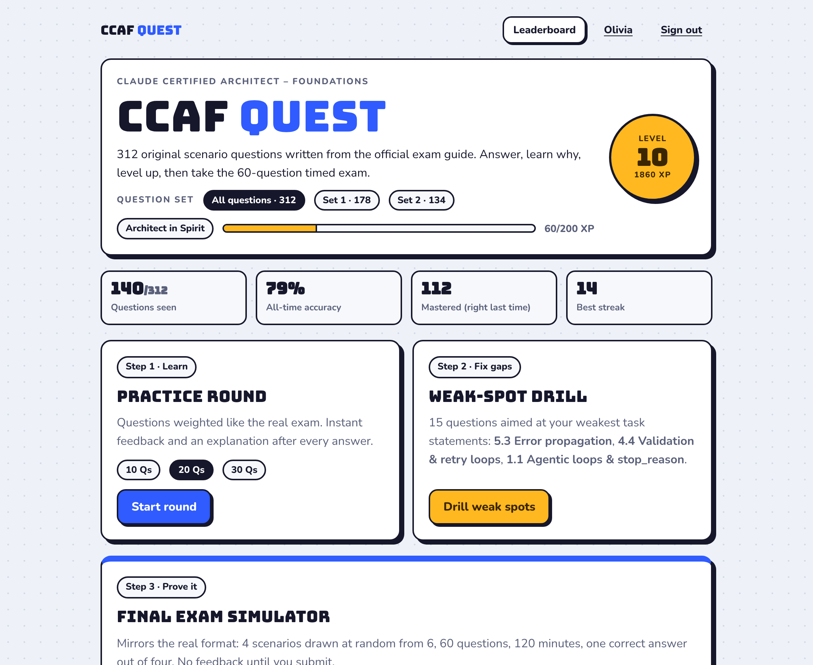
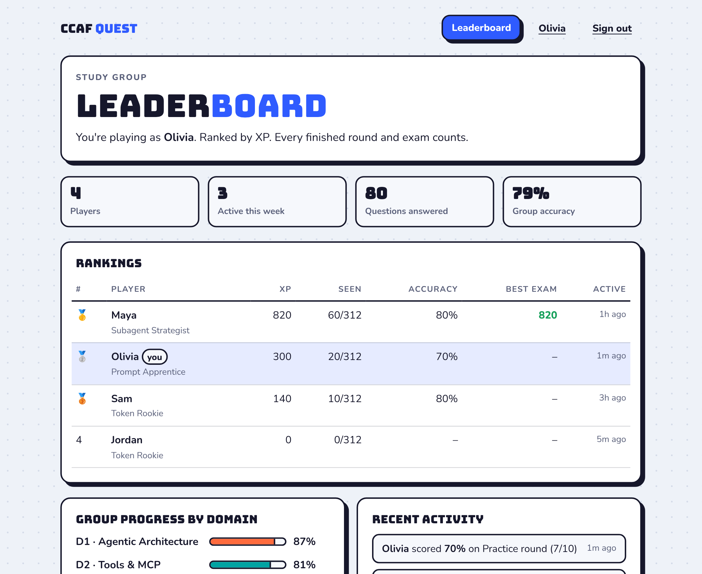

# Context Club

**Gamified practice for tech exams, built so a group of friends can prepare together. The first track covers the Claude Certified Architect – Foundations (CCAF) exam.**

### ▶ [Try it live: ccaf-quest-rust.vercel.app](https://ccaf-quest-rust.vercel.app)

Free to use, no install. Play as a guest, or create an account to save your progress and join the leaderboard.

| Practice home | Study-group leaderboard |
| --- | --- |
|  |  |

<sub>Screenshots use sample players.</sub>

---

## Why I built it

I was preparing for the CCAF exam, and so were some of my friends. We were passing a single HTML file around, practicing alone in our own browsers, with no idea how anyone else was doing. I wanted one place where we could all practice, see what we each got wrong, and keep each other motivated.

## Features

- **312 original practice questions** in two sets (178 + 134), written from the public CCAF exam guide. Each one is tagged by exam domain, task statement and scenario, and every answer comes with an explanation.
- **Practice rounds** weighted like the real exam (27 / 18 / 20 / 20 / 15 % across the five domains), with instant feedback.
- **Weak-spot drill** that finds your lowest-scoring task statements and builds a 15-question round around them. Questions you miss come back first until you get them right.
- **Final exam simulator** that mirrors the real format: 4 of 6 scenarios at random, 60 questions, a 120-minute timer, flag-for-review, and a scaled score against the 720 pass mark.
- **Accounts and synced progress**: sign in with email and password, and your history follows you across devices. Guests keep progress in their browser and can upgrade later without losing it.
- **Study-group leaderboard**: XP rankings, best exam scores, group accuracy by domain (with a one-click drill on the group's weakest area) and a live activity feed.
- **"Ask Claude about this"** on every answered question opens Claude with the question, options and explanation already filled in.
- **Game feel**: XP, streak bonuses, levels and ranks, confetti, keyboard shortcuts, light and dark themes, and a layout that works on phones.

## Architecture

Context Club is a static front end (HTML and vanilla JavaScript, no build step) backed by a hosted Postgres database with email sign-in. Access rules live in the database itself through row-level security: anyone can read the leaderboard, but each player can only change their own profile, add their own results and see their own detailed progress. Emails are never shown to other players. Every push to GitHub deploys the site automatically.

## Project structure

```
index.html            the whole app: UI, game logic, sync and leaderboard
questions.json        Set 1 (178 questions)
questions-set2.json   Set 2 (134 questions)
config.js             site settings
```

## How to use

1. Open [ccaf-quest-rust.vercel.app](https://ccaf-quest-rust.vercel.app). You can start right away as a guest.
2. To save your progress and join the leaderboard, choose **Sign in** and create an account with your email and a password. Anything you did as a guest carries over.
3. Pick a question set: Set 1, Set 2, or both.
4. Practice with a **practice round**, a **weak-spot drill**, or the full **final exam** simulator.
5. Open the **Leaderboard** to see rankings, the group's progress by domain and recent activity. You can change your nickname there too.
6. After answering a question, use **Ask Claude about this** to talk it through with Claude.

## How it was built

I designed the product and its study features, chose the architecture, and set the data-privacy rules: what is public, what stays private to each player, and what the database must refuse. I tested every release on the live site. I used AI-assisted development (Claude) to speed up writing the code. The project started as a single-file practice quiz and grew into a hosted multi-user app with accounts, a database and a leaderboard.

## About the questions

All questions are original practice items written from the public exam guide. They are not real exam questions. This is an independent study aid and is not affiliated with or endorsed by Anthropic.

---

© 2026 Olivia ([olivia-xuan](https://github.com/olivia-xuan)). All rights reserved.
